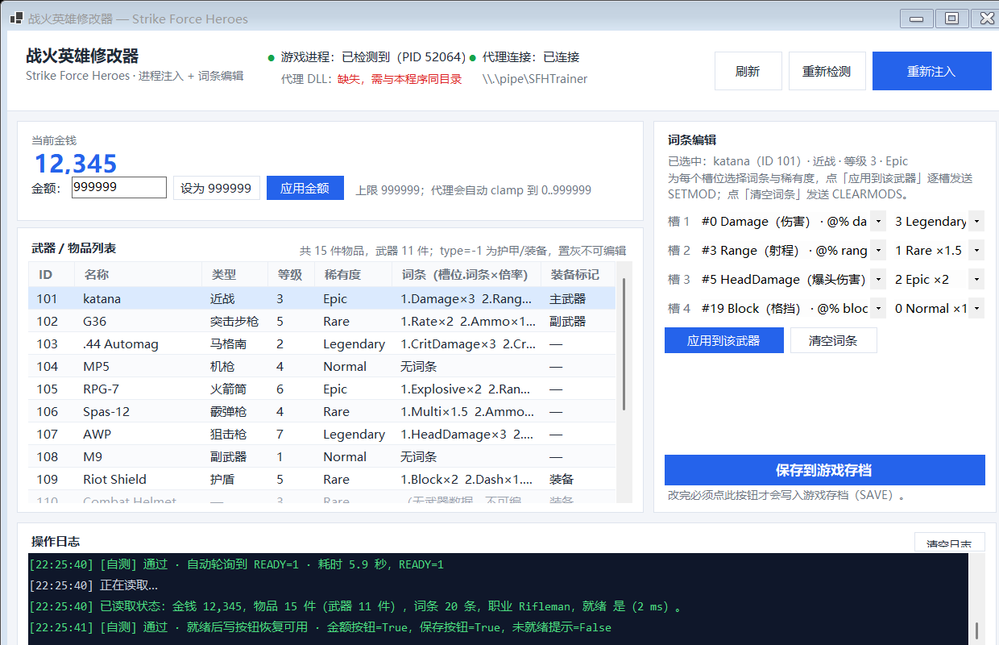
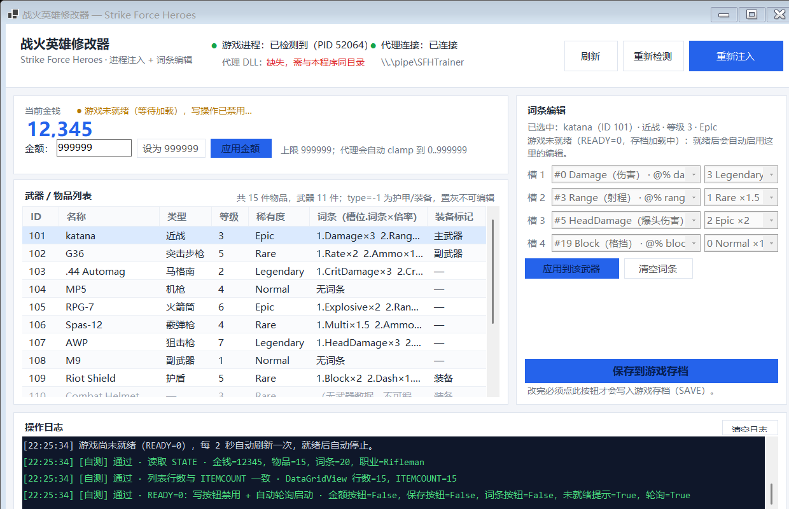

# SFHTrainer.exe —— 修改器 GUI（.NET 8 WinForms）

本目录是「战火英雄修改器」的图形界面：查找 `Strike Force Heroes.exe` → 释放/注入内嵌的 `sfh_agent.dll` →
通过命名管道 `\\.\pipe\SFHTrainer` 与注入代理通信，提供金钱修改、武器列表、4 槽词条编辑和存档保存。

通信契约只有一个：[`../docs/AGENT_PROTOCOL.md`](../docs/AGENT_PROTOCOL.md)（v1.1）。
界面里所有字段、命令、错误码都严格按它实现，没有自造字段，也不会重排 MOD index。

---

## 1. 目录结构

```
gui/
├─ SFHTrainer.sln                    # 解决方案（可选，方便 IDE 打开）
├─ SFHTrainer/
│  ├─ SFHTrainer.csproj              # net8.0-windows / WinForms / x64
│  ├─ app.manifest                   # asInvoker（需要时手动以管理员运行）
│  ├─ Program.cs                     # 入口 + 命令行开关
│  ├─ MainForm.cs                    # 全部界面代码（纯手写，无 designer）
│  ├─ TrainerController.cs           # 业务逻辑：检测/注入/连接/命令/刷新
│  ├─ SelfTest.cs                    # --selftest 无界面端到端自测
│  ├─ DisplayNames.cs                # 枚举、稀有度、词条的中文展示映射
│  ├─ Injection/ProcessInjector.cs   # OpenProcess→VirtualAllocEx→WriteProcessMemory→CreateRemoteThread
│  └─ Protocol/
│     ├─ AgentClient.cs              # 命名管道客户端（async、按行、超时、重连）
│     ├─ StateModels.cs              # STATE 解析（含 READY）
│     └─ AgentProtocolException.cs   # ERR code → 中文提示
└─ test/
   ├─ mock_agent.py                  # 假代理（ctypes 实现命名管道服务端，无需 pywin32）
   └─ screenshots/                   # 自测时抓的界面截图
```

---

## 2. 构建

需要 **.NET 8 SDK**（`dotnet --version` ≥ 8.0）。构建命令（二者等价）：

```powershell
cd gui
dotnet build -c Release                      # 走解决方案

# 或者只构建项目
cd gui\SFHTrainer
dotnet build -c Release
```

实测结果（2026-10-23，SDK 8.0.411）：

```
dotnet build -c Release  →  已成功生成。 0 个警告 / 0 个错误
产物: gui\SFHTrainer\bin\Release\net8.0-windows\SFHTrainer.exe (+ dll / deps.json / runtimeconfig.json)
```

### 打包用的单文件产物

`bin\Release\...\SFHTrainer.exe` 需要同目录的 `SFHTrainer.dll`、`SFHTrainer.deps.json`、
`SFHTrainer.runtimeconfig.json` 才能跑。给 `dist/` 用的话，发布成单文件：

```powershell
cd gui\SFHTrainer
dotnet publish -c Release -r win-x64 --self-contained false -p:PublishSingleFile=true -o ..\..\dist
```

产物：`dist\SFHTrainer.exe`（约 416 KB，单文件，注入代理已内嵌）。

> 这是**框架依赖**发布：目标机器需要安装 **.NET 8 Desktop Runtime（x64）**，否则双击无反应或提示缺少框架。
> 不装运行时也行，但要把 `--self-contained true` 一起加上（体积会到 60 MB 以上）。

**运行前提**：代理 DLL 已作为嵌入资源打进 `SFHTrainer.exe`，分发只需一个文件。
运行时会释放到 `%LOCALAPPDATA%\SFHTrainer\agent\agent_<hash>.dll` 再注入；界面顶部显示「代理 DLL：已内嵌（已释放）」。

---

## 3. 实现说明

### 3.1 进程检测

- 按进程名 `Strike Force Heroes`（`Process.ProcessName` 形态）枚举，比较时忽略大小写，不读模块、不需要权限。
- 进程不存在时顶部显示 **「游戏进程：未启动」**，并提供「重新检测」按钮随时重查。
- 只检测，**从不启动、不关闭**游戏进程。

### 3.2 注入（`Injection/ProcessInjector.cs`）

严格按协议 §1 的顺序：

```
OpenProcess(PROCESS_ALL_ACCESS)            失败则退回安全权限掩码再试一次
  → 位数检查（IsWow64Process：目标是 32 位则直接报错）
  → VirtualAllocEx(MEM_COMMIT|MEM_RESERVE, PAGE_READWRITE)
  → WriteProcessMemory(UTF-16 的 DLL 绝对路径 + 结尾 \0)
  → GetModuleHandleW("kernel32.dll") + GetProcAddress("LoadLibraryW")
  → CreateRemoteThread(LoadLibraryW, remotePath)
  → WaitForSingleObject(15s) + GetExitCodeThread  ← 返回 0 视为 DLL 加载失败
  → 释放远程内存、关闭句柄
```

失败时**每个阶段都带 Win32 错误码**写进日志，例如：

```
注入失败 @ OpenProcess（Win32 错误码 5）：拒绝访问（错误 5）。请以管理员身份运行本程序；
若游戏由 Steam 以管理员启动，本程序也必须提升权限。
注入失败 @ LoadLibraryW：LoadLibraryW 返回 0：DLL 加载失败。常见原因：DLL 位数不匹配（需要 x64）、
缺少依赖 DLL，或 sfh_agent.dll 路径不可读。
```

### 3.3 管道客户端（`Protocol/AgentClient.cs`）

- `NamedPipeClientStream(".", "SFHTrainer", PipeDirection.InOut, PipeOptions.Asynchronous)`。
- **UTF-8、`\n` 分行、`\t` 分列**：`StreamReader`/`StreamWriter` 固定 UTF-8 无 BOM，`NewLine = "\n"`。
- 读端是一个后台任务，把行推进 `Channel<string>`；写命令时用一个 `SemaphoreSlim` 串行化，
  每次发一条命令、按行收响应，**全部 `await`，UI 线程不阻塞**。
- `STATE` 按块读到 `END`；其他命令读一行；`ERR <code> <msg>` 抛 `AgentProtocolException`（带中文提示）。
- 超时：STATE 12 秒、普通命令 8 秒、PING 4 秒；超时抛「等待代理响应超时」。
- 注入后连接失败**最多重试 10 次**（每次 5 秒连接超时 + 600 ms 间隔），日志逐次打印，最后给出排查提示。
- 连上后再发一次 `PING`，确认代理主循环活着（回 `PONG`）。

### 3.4 界面（`MainForm.cs`，纯代码手写，微软雅黑）

```
┌ 顶部状态栏：游戏进程 ● / 代理连接 ● / 代理 DLL 状态 │ 刷新 │ 重新检测 │ 注入代理 ┐
├────────────────────────────────┬──────────────────────────────┤
│ 金钱卡：当前金钱 + 未就绪提示    │ 词条编辑                      │
│   金额输入 │ 设为 999999 │ 应用金额 │  已选中：xxx（ID/类型/等级/稀有度）│
├────────────────────────────────┤  槽 1..4：词条下拉 + 稀有度下拉  │
│ 武器/物品列表（DataGridView）    │  应用到该武器                  │
│ 分类筛选 + ID│名称│类型│等级│稀有度│词条摘要│装备 │  保存到游戏存档       │
├────────────────────────────────┴──────────────────────────────┤
│ 操作日志（彩色、带时间戳、可清空）                                │
└───────────────────────────────────────────────────────────────┘
```

- **分类筛选**：列表上方「分类」下拉，可选全部类型 / 护甲装备 / 突击步枪 / 机枪 / 马格南 / 近战 / 杂项 / 火箭筒 / 副武器 / 护盾 / 霰弹枪 / 狙击枪，切换后立即按 `ITEM.type` 过滤。
  `type=-1`（护甲/装备）行整行置灰、摘要显示「（无武器数据，不可编辑）」，选中它时右侧词条面板禁用。
- **中文名称**：物品名与词条名都来自游戏自带中文语言表（`WeaponData.GetLocalizedName` / `Mod.*`），无需运行时联网或翻译表。\n- **词条下拉**：只显示中文描述 + 基础百分比（如「伤害4%」「发射额外炮弹几率5%」），不带英文和序号，
  展开宽度 640 px；回传时只用该行的 `index`，**不重排**。
- **槽位稀有度下拉**：0 普通 ×1 / 1 稀有 ×1.5 / 2 史诗 ×2 / 3 传说 ×3（名称与倍率优先取 STATE 的 `RARITY` 行）。
- **武器稀有度**：单独的下拉（0..6，名称来自 STATE 的 `RARITY` + 原型/大便/创意工坊），点应用时先发 `SETRARITY`。
- **皮肤**：下拉列出 `CAMO` 目录里的全部迷彩（含角色/工坊皮肤；十字弩的「劫掠者」也在内），点应用时先发 `SETCAMO`，代理会调用 `ApplyModsLevelCamo` 立即套用。
- **应用到该武器**：先 `SETRARITY`（武器稀有度）、`SETCAMO`（皮肤），再对 4 个槽位**逐槽**发送 `SETMOD <itemId> <slot> <modIndex> <rarity>`，最后统一刷新 STATE。

- 应用金额：本地先校验 0..999999（越界直接提示，不发送），代理侧仍会 clamp。
- 所有写操作成功后都重新拉一次 `STATE` 刷新界面（协议 §5 要求）。
- ERR 翻译：1 游戏尚未就绪 / 2 参数不合法 / 3 找不到该物品 / 4 无武器数据 / 5 词条序号无效 / 6 写入失败，
  原文附在括号里便于对账。
- 关窗口时发 `QUIT` 再断开管道（先取消轮询、再 QUIT、最后 dispose）。

### 3.5 协议 v1.1（READY）实现

- `STATE` 里 `MONEY` 之后的 `READY <0|1>` 会被解析成 `GameState.Ready`（老代理不发这一行时按 READY=1 处理，向后兼容）。
- `Ready=0` 时：金钱区显示琥珀色 **「● 游戏未就绪（等待加载），写操作已禁用…」**，
  「设为 999999」/「应用金额」/「应用到该武器」/「保存到游戏存档」全部置灰（Flat 按钮不会自动变灰，代码里手动上色）；
  控制器层也会直接拦下写命令，连一条都不会发出去。
- 注入/连接成功后若 `READY=0`，界面**每 2 秒自动拉一次 STATE**（`System.Windows.Forms.Timer`），
  日志会写「游戏尚未就绪（READY=0），每 2 秒自动刷新一次，就绪后自动停止」；
  一旦读到 `READY=1` 立即停止轮询并写「游戏已就绪（READY=1），可以修改了」。
- `ITEM` 的 `name` 为空时回退显示 **「未命名武器 #<id>」**（`DisplayNames.ItemName`），列表、标题、日志都用这个回退名。

### 3.6 命令行开关

| 开关 | 说明 |
| --- | --- |
| （无） | 正常启动界面，连生产管道 `\\.\pipe\SFHTrainer` |
| `--pipe-name <名字>` | 临时换管道名（**只给测试用**） |
| `--selftest` | 无界面端到端自测，退出码 0=全通过 / 1=有失败 |
| `--selftest-out <路径>` | 自测报告写到指定文件 |
| `--selftest-ui` | 开真窗口跑一遍界面级自测，结束后写报告并按退出码返回 |
| `--screenshot <路径>` | 自测时用 `DrawToBitmap` 把窗口自身存成 PNG（`-notready` / `-ready` / `-final` 三张） |
| `--hold <秒>` | 配合 `--selftest-ui`，自测完继续留窗口 N 秒（方便人工/截图核对） |

> 安全设计：**自测模式（`--selftest` / `--selftest-ui`）默认连 `\\.\pipe\SFHTrainerMock`，不是生产管道**。
> 这样即使游戏里已经注入了真代理，自测也不会误连、不会改真实存档、不会把代理 QUIT 掉。

---

## 4. 自测（mock 管道服务端，不碰游戏）

`gui/test/mock_agent.py` 只用 `ctypes` 调 Win32（不需要 pywin32），按协议实现服务端，返回假 STATE：

- 15 件物品（11 件武器 + 4 件 `type=-1` 护甲/装备，另含 1 件 **空名字**武器 `#115`）、20 条真实词条名、4 档稀有度。
- 完整命令语义：`SETMONEY`（clamp 0..999999）、`SETRARITY`（0..6）、`SETCAMO`（-1=无皮肤）、`SETMOD`（校验 item/slot/mod/rarity）、`SAVE`、`REFRESH`、`PING`、`QUIT`。
- 错误码：3 物品不存在、4 无武器数据、5 词条序号无效、2 参数错、**1 未就绪**。
- `--ready-after N`：先返回 `READY=0`，N 秒后变 `READY=1`（模拟存档加载），期间所有写命令回 `ERR 1 not-ready`。

### 4.1 用例 A —— 无界面自测（mock 立刻就绪）

```powershell
# 终端 1：起 mock（默认 pipeline SFHTrainerMock）
F:\1Software\Python\python.exe "gui\test\mock_agent.py" --pipe-name SFHTrainerMock --verbose

# 终端 2：跑自测
cd "gui\SFHTrainer\bin\Release\net8.0-windows"
.\SFHTrainer.exe --selftest --pipe-name SFHTrainerMock --selftest-out C:\temp\sfh_selftest.txt
echo EXITCODE=$LASTEXITCODE
Get-Content C:\temp\sfh_selftest.txt
```

覆盖：连接 → PING → STATE 解析（含 READY/词条 20 条/稀有度 4 档/type=-1/空名字回退）→ SETMONEY 888888 →
越界金额拦截 → SETMOD×4 回读一致 → 词条摘要渲染 → SAVE → REFRESH →
ERR 1/2/3/4/5 中文翻译 → 只读进程检测 → QUIT。

**实测：PASS 23/23（退出码 0）。**

### 4.2 用例 B —— 未就绪流程（模拟存档加载中）

```powershell
F:\1Software\Python\python.exe "gui\test\mock_agent.py" --pipe-name SFHTrainerMock --ready-after 6
.\SFHTrainer.exe --selftest --pipe-name SFHTrainerMock --selftest-out C:\temp\sfh_selftest_ready.txt
```

覆盖额外项：`READY=0` 时 GUI 拦下写命令、`ERR 1` 中文提示、等待 `READY` 变 1（实测 5.1 秒）后继续跑完整流程。

**实测：PASS 26/26（退出码 0）。**

### 4.3 用例 C —— 界面级自测（真窗口，走真实按钮处理流程）

```powershell
F:\1Software\Python\python.exe "gui\test\mock_agent.py" --pipe-name SFHTrainerMock --ready-after 6
.\SFHTrainer.exe --selftest-ui --pipe-name SFHTrainerMock `
    --selftest-out C:\temp\sfh_ui.txt --screenshot C:\temp\ui.png --hold 30
```

它会自己：连 mock → 拉 STATE →（READY=0 时）断言写按钮禁用 + 自动轮询 → 等到 READY=1 →
断言按钮恢复 → 校验空名字回退 → 校验 type=-1 置灰 → 填金额框点「应用金额」→ 选武器 → 设 4 个槽位点「应用到该武器」→
点「保存到游戏存档」→ 校验 ERR 3/4/5 中文提示 → 只读检测进程 → QUIT → 关窗。

**实测：PASS 19/19，退出码 0；报告在 `--selftest-out` 指定文件，截图见 `gui/test/screenshots/`。**





### 4.4 用例 D —— 单文件发布产物自测

```powershell
F:\1Software\Python\python.exe "gui\test\mock_agent.py" --pipe-name SFHTrainerMock
cd dist
.\SFHTrainer.exe --selftest --pipe-name SFHTrainerMock --selftest-out C:\temp\sfh_pub_test.txt
```

**实测：PASS 23/23（退出码 0）**，说明打包后复制到 `dist/SFHTrainer.exe` 的单文件版本也能正常连管道、读状态、改词条、保存。

### 4.5 手工点测（可选）

1. 起 mock（`--ready-after 5`），启动 `SFHTrainer.exe`，点「注入代理」——真游戏没开，会看到
   「未检测到游戏进程…」+ 注入失败提示（这是预期，注入路径需要真游戏）。
2. 想手工验证界面数据：起 mock 后运行 `--selftest-ui --hold 300`，窗口会带着假数据停在屏幕上，随便点。
3. 关闭窗口，确认 mock 端日志出现 `<< QUIT`（说明关窗会正确通知代理）。

---

## 5. 已知限制 / 未做

- **真实注入没有在本次任务里联调**：本任务的约束是绝不启动/关闭游戏、不注入真实游戏，注入和真代理的联调由 Lead 负责。
  本程序注入路径的每个失败点都有 Win32 错误码日志，真联调时按日志定位即可。
- **必须 x64**：程序按 `PlatformTarget=x64` 编译；32 位目标会被主动拒绝（位数不匹配时 `LoadRemoteThread` 会失败）。
- **可能需要管理员权限**：若游戏由 Steam 以管理员身份启动，本程序也得以管理员运行，否则 `OpenProcess` 返回错误 5。
- **读取超时后需要重新刷新**：管道是「发一条收一条」的串行模型；某条命令超时后，迟到的响应可能让下一条对不上，
  此时点「刷新」或重新注入即可恢复（界面上不会卡死）。
- 没有做「单实例锁」：同时开两个窗口会对同一个管道抢连接（代理只有一个实例时第二个连不上，会提示重试失败）。
- 保存后游戏内仓库界面要重新打开才按新数据重建（协议 §4 的说明）。
- 注入后 `LoadLibraryW` 已成功但 DLL 自己起不来（例如找不到依赖）时，界面表现为「连接管道 10 次全失败」，
  排查提示已写在日志里。

---

## 6. 边界声明

本目录只实现 GUI。开发过程中：

- 未修改 `agent/` 与协议文档；GUI 只按 `docs/AGENT_PROTOCOL.md` 收发命令；
- 未启动、未关闭游戏进程，未对真实游戏注入，未写任何游戏存档；
- 与真代理相关的字段、命令、错误码全部照 `docs/AGENT_PROTOCOL.md`（v1.0 + v1.1 的 READY）实现，没有臆造字段。


